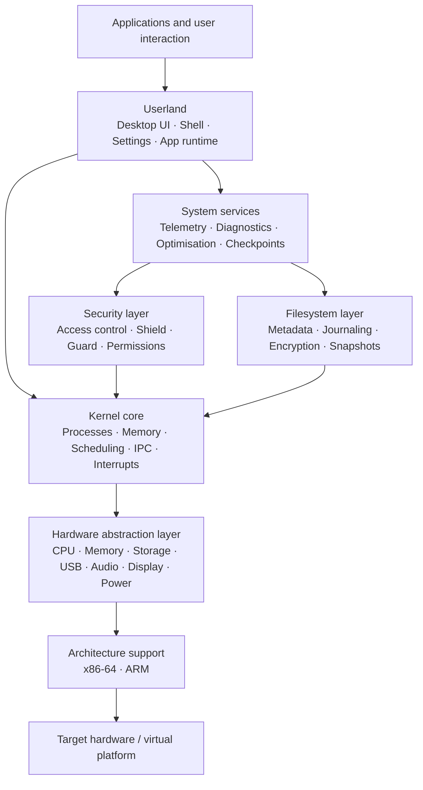
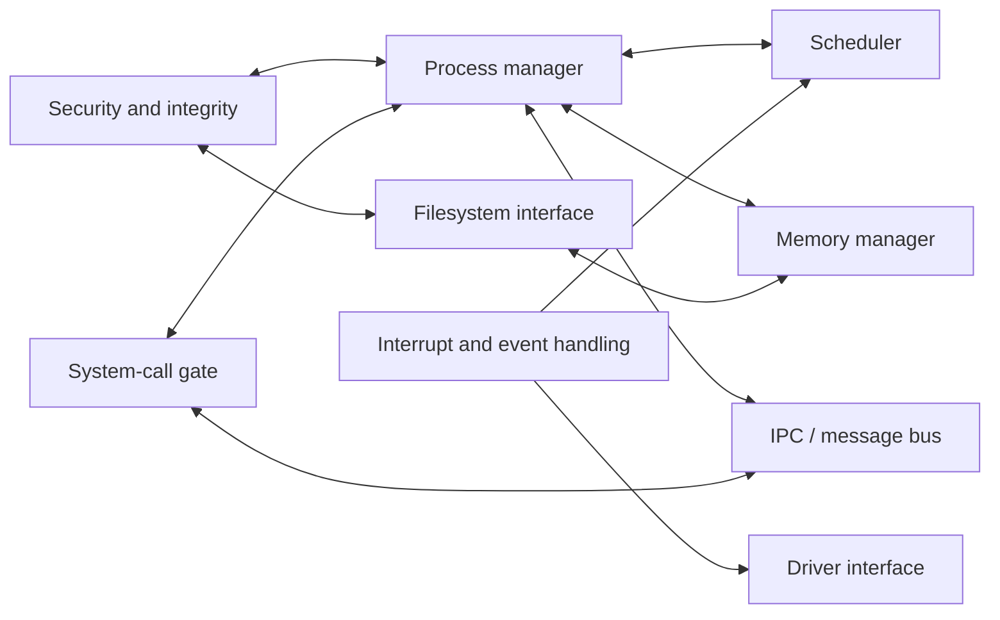
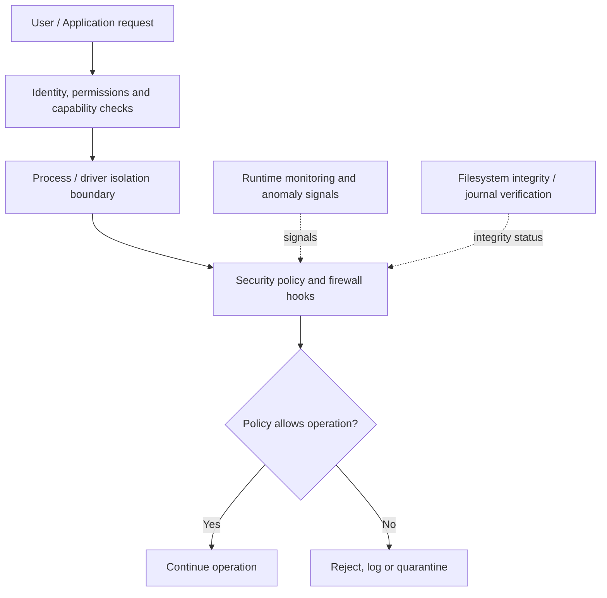

<!--
  AegisOS README
  Keep screenshots in docs/assets/ and update the image paths below.
-->

<p align="center">
  
</p>

<h1 align="center">AegisOS</h1>
<h3 align="center">Hybrid Secure Intelligence Operating System</h3>

<p align="center">
  <em>A security-first operating-system research project with a modular kernel architecture, a desktop simulation environment, and layered system-protection concepts.</em>
</p>

<p align="center">
  <a href="https://github.com/HYDRAGAMERZOFFICIAL/Aegis-os"></a>
  
  
  
  
</p>

<p align="center">
  <a href="#-overview">Overview</a> •
  <a href="#-what-you-can-run-today">Run it</a> •
  <a href="#-system-architecture">Architecture</a> •
  <a href="#-security-model">Security</a> •
  <a href="#-documentation">Documentation</a>
</p>

---

## 🛡️ Overview

**AegisOS** is an experimental operating-system project exploring how a modular kernel, hardware abstraction, user-space services, and security-focused system components can fit together into one coherent platform.

The project has two complementary parts:

1. **AegisOS system foundation** — C-based kernel and subsystem code, architecture-specific support for x86-64 and ARM, a hardware abstraction layer (HAL), and interfaces for services, drivers, filesystem features, and userland.
2. **AegisOS simulator** — a browser-based desktop experience and a native command-line simulator that let you explore the project's concepts without booting it on physical hardware.

The goal is to explore a system that combines the flexibility of a modern desktop with a security-first design: isolation, explicit access control, integrity checking, recovery mechanisms, and system observability.

> [!IMPORTANT]
> **Project maturity:** AegisOS is an experimental/alpha development project. The repository includes runnable simulators and a substantial body of system code and interfaces, but this README does not claim that every subsystem is production-ready or that a complete, installable, general-purpose OS image is available. Hardware boot, driver coverage, integration, and security validation must be evaluated separately from simulator demonstrations.

## ✨ Design goals

| Pillar | What it means in AegisOS |
|---|---|
| **Isolation by design** | Keep process, driver, and service boundaries explicit; use capability- and permission-oriented interfaces. |
| **System integrity** | Explore journaling, cryptographic verification, snapshots, and recovery-oriented filesystem design. |
| **Observable system behaviour** | Expose process, scheduler, security, and telemetry information to support debugging and diagnosis. |
| **Adaptive desktop experience** | Experiment with different desktop layouts, window management, themes, and command-driven workflows. |
| **Modular architecture** | Keep kernel, architecture support, HAL, drivers, services, security, filesystem, and userland concerns separated. |
| **Cross-architecture direction** | Organize low-level support around x86-64 and ARM targets, subject to implementation and hardware validation. |

## 🚀 What you can run today

### 1. Interactive web desktop simulator

The web simulator is the easiest way to explore the AegisOS interface and system concepts.

**Requirements**
- Node.js (LTS recommended)
- npm
- A modern web browser

**Start**

```bash
git clone https://github.com/HYDRAGAMERZOFFICIAL/Aegis-os.git
cd Aegis-os
npm install
npm start
```

Open **http://localhost:3000** in your browser.

You can also start the server directly:

```bash
node simulator/server.js
```

On Windows, use the included launcher:

```bat
run_sim.bat
```

The launcher offers the web simulator, native CLI simulator, automated demo, and test-suite option.

### 2. Native CLI simulator

A prebuilt Windows executable is included in the repository.

```powershell
.\aegis_sim.exe
```

Run its demonstration mode:

```powershell
.\aegis_sim.exe --demo
```

> The committed executable is a Windows build. To build native components on another platform, follow the relevant compiler/build instructions in the project guides rather than assuming this executable is portable.

## 🖥️ Simulator experience

The browser simulator is designed to make AegisOS concepts tangible. Depending on the simulator build, the available demonstrations include:

| Area | What it demonstrates |
|---|---|
| Desktop and windows | Window creation, dragging, resizing, minimizing, maximizing, and focus changes. |
| Layout modes | Aegis Hybrid, Windows-inspired, and Linux-inspired desktop arrangements. |
| Themes | Quantum Cyan, Cyberpunk Amber, Deep Space Dark, and Crystal Light visual themes. |
| Command palette | Search and launch simulator actions using **Ctrl + Space** or the search control. |
| Aegis Shell | Interactive terminal-style interface, command history, and command completion. |
| System telemetry | Visual activity stream and system-event monitoring concepts. |
| Aegis Shield | Firewall-rule and packet-inspection concepts. |
| Aegis Guard | Heuristic threat-detection and scan simulation. |
| Zero-trust console | Access-token and gate-status concepts. |
| Filesystem recovery | Simulated corruption, integrity detection, and recovery workflow. |
| Task profiles | Game, Work, Streaming, and Eco profile demonstrations. |
| Diagnostics | Guided checks across selected simulated subsystems. |

The simulator is an educational and development interface. A visual demonstration should not be interpreted as proof that the corresponding protection is active in a real kernel or on a host machine.

## 🖼️ Screenshots

Screenshots make it easier to understand the simulator before installing it. Add real captures from your local run to `docs/assets/` and keep the names below, or change the paths to match your files.

<table>
  <tr>
    <td align="center" width="50%">
      <strong>Desktop environment</strong><br>
      
      <sub>Desktop shell, windows, dock, and system status.</sub>
    </td>
    <td align="center" width="50%">
      <strong>Security console</strong><br>
      
      <sub>Security controls and simulated threat-monitoring views.</sub>
    </td>
  </tr>
  <tr>
    <td align="center">
      <strong>Neural telemetry</strong><br>
      
      <sub>Live-style activity and event visualisation.</sub>
    </td>
    <td align="center">
      <strong>Filesystem recovery</strong><br>
      
      <sub>Integrity-check and recovery demonstration.</sub>
    </td>
  </tr>
</table>

## 🧭 System architecture

AegisOS is organised as layers. Each layer has a focused responsibility and communicates with adjacent layers through defined interfaces.



### Layer responsibilities

| Layer | Responsibility | Repository area |
|---|---|---|
| **Userland** | Desktop environment, shell, settings, application runtime, and store interfaces. | `userland/` |
| **Services** | Higher-level facilities such as command palette, system monitoring, troubleshooting, task profiles, and checkpoints. | `services/` |
| **Security** | Security policy and enforcement-oriented components, including access control, application permissions, and threat-monitoring modules. | `security/` |
| **Filesystem** | File operations, metadata, integrity concepts, journaling, encryption, indexing, and snapshot/versioning interfaces. | `filesystem/` |
| **Kernel** | Process and thread management, memory, scheduling, interrupts, IPC, system-call boundary, and profiling. | `kernel/` |
| **HAL and drivers** | Hardware-facing interfaces and device-specific functionality. | `hal/`, `drivers/` |
| **Architecture** | CPU-specific setup and low-level implementation for supported target families. | `arch/` |
| **Common utilities** | Shared data structures, helpers, and foundational routines. | `common/` |
| **Developer interfaces** | APIs and integration points intended for system and application developers. | `devapi/` |

### Kernel subsystem view

The kernel code is organised around several cooperating subsystems:



- **Process management** represents process and thread lifecycle responsibilities.
- **Memory management** covers page allocation, mapping, protection, and address-space concerns.
- **Scheduling** coordinates runnable work and scheduling policies.
- **Interrupt handling** provides the low-level path for hardware and software events.
- **IPC** provides mechanisms for communication and synchronisation between components.
- **Security and integrity** provides hooks for access checks, monitoring, and integrity-oriented operations.
- **Filesystem integration** provides the kernel-facing boundary for storage operations.

## 🔐 Security model

AegisOS is designed around defence in depth: multiple controls, each reducing a different class of risk.



Security-related components and concepts represented in the repository include:

- **Zero-trust access control:** explicit permission decisions instead of implicit trust.
- **Aegis Shield:** firewall and network-monitoring concepts.
- **Aegis Guard:** heuristic threat detection and suspicious-activity monitoring concepts.
- **Application permissions:** permission-oriented application access.
- **Driver isolation:** interfaces and design work for restricted driver execution.
- **Filesystem integrity:** journaling, hashes/Merkle-tree concepts, snapshots, and recovery workflows.
- **Cryptographic support:** cryptographic utilities and file-encryption-related modules.

> [!WARNING]
> AegisOS has not been represented here as independently security-audited. Do not use it to protect production systems or sensitive data. Simulator threat percentages, recovery timings, and visual indicators are demonstration values unless independently measured and documented for the actual implementation.

## 🧰 Technology and build environment

The repository currently contains code and tooling in the following areas:

| Technology | Role |
|---|---|
| **C** | Kernel, architecture-specific code, system modules, and native simulator components. |
| **JavaScript / Node.js** | Browser simulator server and project scripts. |
| **Rust** | Hardware abstraction layer crate/build work under `hal/`. |
| **CMake** | Native project build organisation where configured. |
| **GCC / MinGW** | Compiler path used by the Windows test launcher. |
| **Mermaid** | Source-controlled architecture and workflow diagrams in this README. |

### Development prerequisites

For the web simulator:
- Node.js and npm
- A modern browser

For native C development:
- GCC or MinGW-w64
- CMake (for CMake-configured targets)
- Git

For the Rust HAL:
- Rust toolchain and Cargo

Exact compiler versions and target-specific build requirements may vary by subsystem. Consult the dedicated guides before building low-level targets.

## 🧪 Tests and validation

The repository includes C test sources and a Windows launcher option for running them. The README previously listed a combined total of 342 test cases; test counts and pass rates can change as the code evolves, so treat any historical result as tied to the exact commit and test command that produced it.

On Windows, the provided launcher exposes a test-suite option:

```bat
run_sim.bat
```

Select the test-suite entry from the menu.

The launcher currently compiles a specific list of source files with GCC/MinGW and executes the generated test runner. For reproducible reporting, record:
- commit SHA,
- compiler and version,
- exact command,
- test output,
- host OS and architecture.

A passing simulator or unit-test run does **not** establish successful boot on physical hardware, complete driver support, or production-grade security.

## 📁 Repository layout

The top-level structure is organised by subsystem:

```text
Aegis-os/
├── arch/                 # Architecture-specific support (x86-64 / ARM)
├── common/               # Shared utilities and data structures
├── devapi/               # Developer-facing interfaces
├── drivers/              # Device-driver components
├── filesystem/           # Filesystem and integrity-related modules
├── guide/                # Developer, HAL, and implementation guides
├── guides/               # Architecture and project documentation
├── hal/                  # Hardware abstraction layer (C / Rust)
├── include/              # Public headers and subsystem interfaces
├── kernel/               # Kernel subsystems
├── security/             # Security and access-control components
├── services/             # System services
├── simulator/
│   ├── native/           # Native simulator support
│   ├── web/              # Web simulator assets
│   └── server.js         # Simulator server
├── tests/                # Test sources
├── userland/             # Desktop, shell, settings, and app interfaces
├── aegis_sim.exe         # Prebuilt Windows CLI simulator
├── package.json          # Node.js scripts and metadata
├── run_sim.bat           # Windows launcher
├── ARCHITECTURE.md       # Kernel architecture notes
├── COMPLETE_ARCHITECTURE.md
├── PROJECT_SUMMARY.md
└── README.md
```

## 📚 Documentation

The repository contains deeper technical documents. Start with these:

| Document | Focus |
|---|---|
| [Kernel architecture](ARCHITECTURE.md) | Kernel subsystem responsibilities and architecture-specific notes. |
| [Complete architecture](COMPLETE_ARCHITECTURE.md) | End-to-end system layers and component relationships. |
| [Project summary](PROJECT_SUMMARY.md) | Project scope, implementation notes, and current work. |
| [Completion summary](COMPLETION_SUMMARY.md) | Summary of modules and implementation work described by the project. |
| [Developer quick start](guide/DEVELOPER_QUICK_START.md) | Getting started with the codebase. |
| [HAL architecture](guide/HAL_ARCHITECTURE.md) | Hardware abstraction layer structure. |
| [HAL developer guide](guide/HAL_DEVELOPER_GUIDE.md) | Working with the HAL. |
| [Implementation roadmap](guide/IMPLEMENTATION_ROADMAP.md) | Planned and ongoing development work. |

## 🛠️ Working on the project

A practical contribution flow:

1. Fork the repository and create a focused branch.
2. Read the relevant architecture and developer guide before changing a subsystem.
3. Keep changes inside the appropriate layer and update shared headers/interfaces as needed.
4. Build the smallest affected target first.
5. Run relevant tests and include the exact command and output in the pull request.
6. Update diagrams or documentation when module responsibilities or interfaces change.

For larger architectural changes, explain the design decision, affected boundaries, failure modes, and how the change is validated.

## 🗺️ Development roadmap

The following are broad areas for continued engineering and validation, not promises about delivery dates:

- Complete and verify the boot path for supported target platforms.
- Integrate kernel, HAL, architecture code, drivers, and userland through stable interfaces.
- Expand hardware support and test on virtual and physical targets.
- Strengthen syscall and IPC boundaries.
- Add repeatable build and continuous-integration workflows.
- Expand automated unit, integration, and hardware-compatibility tests.
- Conduct independent security review, fuzzing, and threat-model validation.
- Improve developer and end-user documentation.

## 🤝 Contributing

Issues and pull requests are welcome. Please include enough context to reproduce the problem and avoid describing planned or simulated functionality as already implemented in the live kernel.

Before opening a pull request, check that:
- the change has a clear scope;
- public interfaces and documentation are updated;
- relevant tests pass;
- security-sensitive changes include a threat/impact explanation;
- screenshots are supplied for visible simulator changes.

## 📄 License

AegisOS is distributed under the **Apache License 2.0**. See the repository's license file for the complete terms.

## 👤 Project

Maintained by [HYDRAGAMERZOFFICIAL](https://github.com/HYDRAGAMERZOFFICIAL).

<p align="center">
  <strong>AegisOS — Explore a more resilient system architecture.</strong><br>
  <sub>Experimental software. Validate before real-world use.</sub>
</p>


---

## 🎮 AegisOS Game (Early Development)

AegisOS is also being developed into a standalone cyberwarfare strategy and operating-system simulation game. The existing desktop simulator remains available as a separate experience.

### Launch the browser campaign prototype

```bash
npm install
npm start
```

Open `http://localhost:3000/game`.

### Launch the desktop application

```bash
npm install
npm run start:desktop
```

### Run game tests and build installers

```bash
npm run test:game
npm run dist:win
```

A Linux AppImage build target is also configured with `npm run dist:linux`.

### Game foundation status

The first development branch introduces a modular campaign engine, ordered mission objectives, simulated threat lifecycle, resource economy, research progression, local save/load, a dedicated command interface, and an Electron desktop launcher.

**Current milestone:** playable first-mission foundation. Steamworks achievements, Cloud Saves, leaderboards, SteamPipe depots, final artwork, and release QA remain future work. The current build is not yet a Steam release candidate.

All game threats and recovery actions are simulated. The game does not execute malware or operate on the player's real network or host files.
