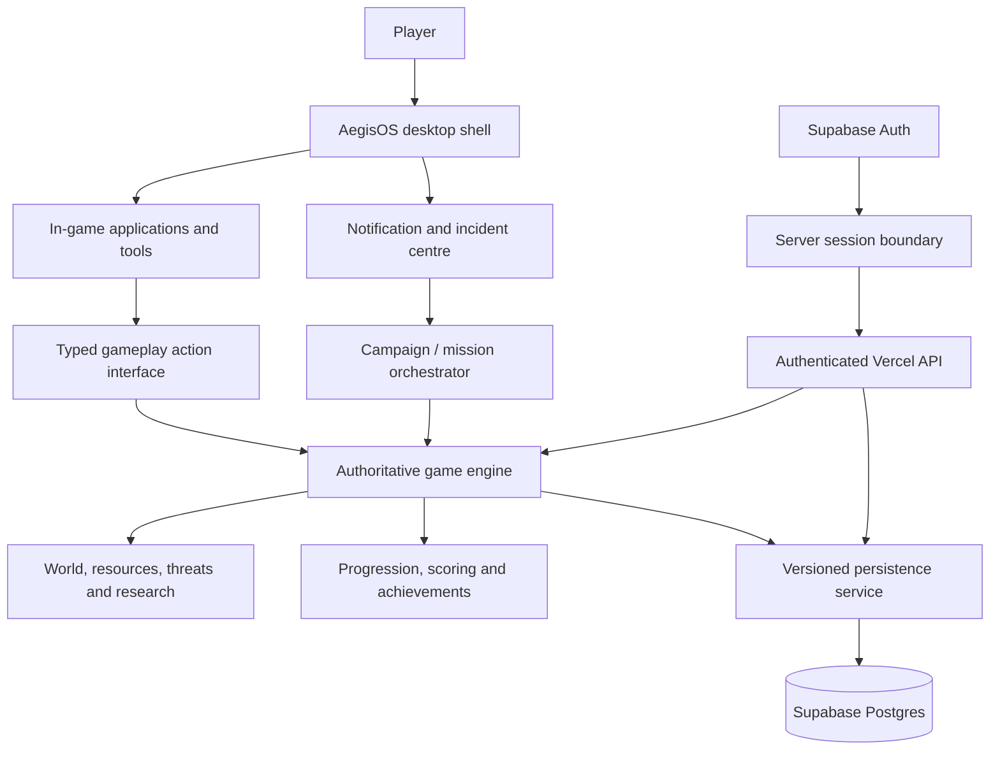

# AEGISOS — THE LAST FIREWALL
## Complete Game Vision, Product Requirements and Build Specification

> **Document purpose:** This is the canonical product/design brief for turning the AegisOS desktop simulator into a continuous, notification-driven cyber-defence strategy game. It records the intended player experience, game rules, mission design, desktop integration, account model, persistence, safety boundaries, and delivery requirements. It is a specification, not a claim that every item below is already implemented.

**Project:** AegisOS  
**Game working title:** AEGIS: THE LAST FIREWALL  
**Genre:** Cyber-defence strategy / operating-system management / investigation / narrative simulation  
**Primary platform:** Web (Vercel deployment)  
**Companion platform:** Existing AegisOS desktop simulator / Electron build  
**Primary mode:** Single-player continuous campaign  
**Player fantasy:** You are the incident commander of a secure operating system. You do not win by pressing one button; you win by understanding evidence, making defensible decisions, using the right tools, managing scarce resources, and keeping a complex digital environment alive.

---

## 1. The idea in one sentence

AegisOS becomes the world the player must defend: realistic-looking system notifications announce incidents, the player investigates them through interconnected desktop tools, and each decision changes the state of the simulated operating system, its resources, its people, its infrastructure, and the next incident.

The game should feel like being responsible for a living security operations centre—not like opening a conventional game, selecting a level, and clicking a single “complete” button.

## 2. Product vision and experience principles

The desktop is the headquarters, not a decorative menu. Notifications are the narrative delivery mechanism, not the entire mission. Applications are instruments that reveal different parts of the same incident. The game engine owns the truth: tools submit actions to the engine, and the engine decides whether an action is valid, what it changes, and what new information becomes available.

The experience must follow these principles:

1. **One continuous world.** The player remains in one AegisOS environment. Incidents arrive over time and flow into one another. The campaign is not a set of disconnected mini-games.
2. **Think before acting.** Important missions require several meaningful steps, evidence gathering, comparison, and a final decision. Opening an app or pressing one button must never clear a substantial quest.
3. **Many tools, one coherent incident.** The player may need to correlate a process list, file metadata, event logs, network telemetry, identity records, firewall rules, backups, and a written incident report.
4. **Consequences persist.** Decisions affect stability, resources, reputation, threat pressure, unlocks, and later missions. A wrong decision can cost time or resources and may create a harder recovery—not simply produce a red “wrong” label.
5. **The game keeps moving.** Once a mission is resolved, the next incident can enter the queue. The player may triage, defer, or prioritise alerts; the campaign should not end after the first few missions.
6. **Fair information, not arbitrary guessing.** Clues must exist in the simulated environment. The player should be able to reason to the answer, and the mission should explain why evidence supports or contradicts a conclusion.
7. **Fictional and safely isolated.** Every attack, target, process, file, packet, account, and endpoint is a game-world object. No mission should require attacking real systems, scanning public networks, executing malware, or modifying host files.

## 3. Narrative premise

AegisOS is being piloted as the trusted operating environment for a network of critical services. A coordinated adversary known as **BLACKOUT** is probing the platform and the organisations that depend on it. Early incidents look unrelated: a suspicious process, encrypted documents, unusual outbound traffic, a hijacked browser session, a kernel integrity anomaly, a service flood, a forged identity, and a tampered software package.

The player is assigned as the new Aegis incident commander. At first, the job appears to be routine triage. Over time, evidence reveals that individual incidents are connected: credentials, build artefacts, infrastructure dependencies, and telemetry gaps form a larger intrusion chain. The player must decide what to contain, what to preserve for forensics, which services to keep online, when to restore, and how much trust to place in evidence.

The central mystery is **BLACKOUT**: who is coordinating the incidents, what access are they seeking, and why is AegisOS itself part of the target? The story should unfold through logs, mission briefings, recovered artefacts, messages, reports, and consequences—not through long unskippable exposition.

### Narrative delivery

- Short incident notifications introduce urgency and a concrete lead.
- Mission briefings state known facts, unknowns, impact, and time pressure.
- Logs, files, messages, and telemetry reveal optional context and hidden connections.
- Debriefings explain the outcome, evidence quality, resource impact, and unresolved leads.
- Recurring characters can appear through secure messages and incident coordination channels. Their advice is useful but not automatically correct; the player must verify important claims.
- A campaign archive preserves resolved cases and discovered links, allowing players to revisit the story.

## 4. Core gameplay loop

The intended loop is:

`World simulation → alert → triage → investigate → form a hypothesis → use tools → contain → recover → report → consequence → next alert`

### Step-by-step mission flow

1. **Alert arrives.** A notification appears with a severity, affected service, timestamp, and short signal. It can be dismissed from view without deleting the incident.
2. **Triage.** The player opens the incident queue, checks impact and dependencies, and chooses whether to respond immediately or defer it. Deferral has a cost when the threat continues to evolve.
3. **Briefing.** The mission panel explains the situation, current intelligence, objectives, constraints, and known risks. It does not reveal the complete solution.
4. **Investigation.** The player opens relevant AegisOS applications and gathers artefacts. Some tools expose clues; others allow actions. Evidence is added to a case ledger with source and timestamp.
5. **Analysis.** The player correlates observations, tests a hypothesis, distinguishes benign activity from hostile activity, and identifies the affected scope.
6. **Decision and execution.** The player chooses a defensive action, configures a policy, isolates a simulated object, preserves evidence, or restores from a verified checkpoint.
7. **Verification.** The player must check whether the action worked. A command being accepted is not the same as the incident being resolved.
8. **Reporting.** The player classifies the incident, records the evidence, explains the action taken, and identifies residual risk.
9. **Debrief.** The engine awards or removes resources and reputation based on evidence quality, response time, collateral impact, and recovery correctness.
10. **Continuity.** The environment changes and another alert may arrive. Some unresolved incidents remain active and can combine into a larger crisis.

### Anti-shortcut requirements

- A mission may contain multiple stages and several independent objectives.
- Critical actions require prerequisite evidence or a justified state transition.
- App launch, notification dismissal, mission selection, and opening a briefing are not mission-completion actions.
- A correct answer to one question cannot bypass the remaining investigation, containment, recovery, and verification steps.
- A final report must be supported by evidence already collected or explicitly marked as an assumption.
- Repeatedly clicking the same control must not award duplicate XP, currency, achievements, or mission completion.
- The engine must reject out-of-order, stale, locked, or already-completed actions.
- The UI should explain missing prerequisites and point to the relevant evidence category without revealing every answer.

## 5. The AegisOS desktop as the game board

The existing AegisOS simulator remains the primary environment. Do not build a separate game launcher that merely decorates or links to a collection of unrelated apps. Integrate the campaign into the desktop and make the desktop's simulated systems respond to game events.

### Core desktop tools and their gameplay roles

| Tool / application | Gameplay responsibility |
|---|---|
| **Aegis Explorer** | Search fictional directories, inspect file metadata, compare timestamps, locate suspicious artefacts, inspect quarantined items, and find recovery snapshots. |
| **Aegis Shell / Terminal** | Run a constrained, fictional command vocabulary for investigation, diagnostics, policy checks, and recovery. It must not pass game commands to the host shell. |
| **Task Monitor** | Inspect simulated processes, parent/child relationships, CPU and memory behaviour, process identity, and anomalous execution chains. |
| **Aegis Shield / Firewall** | Review fictional network flows, inspect rule sets, configure allow/deny policies, rate limits, and segmented routes. |
| **Aegis Guard** | Run simulated scans, review detections, compare threat indicators, and manage quarantine decisions. |
| **Log Viewer / Event Monitor** | Search, filter, correlate, and bookmark system events across time and subsystem. |
| **Network Monitor** | Inspect simulated packet summaries, connections, DNS events, traffic volumes, and destination reputation. |
| **Identity Vault / Zero-Trust Console** | Review users, sessions, tokens, access scopes, sign-in events, and capability grants; revoke or rotate compromised game-world credentials. |
| **Backup & Restore** | Inspect snapshot lineage, verify integrity, compare recovery points, and restore selected fictional data or services. |
| **Secure Vault** | Store recovered evidence and protected case artefacts within the simulation. |
| **Settings / System Control** | Adjust game-world service policies, resource allocation, security posture, and system preferences where mission objectives permit. |
| **Code Editor / Build Inspector** | Inspect fictional configuration, scripts, manifests, dependency files, and software-build metadata. |
| **AegisPKG / Package Inspector** | Verify package origin, signatures, versions, dependencies, and provenance before installation in the simulation. |
| **API Debugger** | Inspect simulated service requests, response codes, rate limits, and service health. |
| **Notes / Office Lite** | Prepare an evidence-backed incident report, recovery plan, or handover note. |
| **Mail / Secure Messages** | Receive fictional mission communications, request information, and verify instructions through trusted channels. |
| **Calendar / Planner** | Review maintenance windows, scheduled jobs, incident deadlines, and upcoming campaign events. |
| **Resource Monitor** | Manage CPU, memory, storage, bandwidth, power, and service capacity as game resources. |

These are intended gameplay responsibilities. Reuse an existing simulator application only when its behaviour genuinely supports the game. If a pre-fitted action is incompatible, misleading, inert, or unrelated, replace or redesign it rather than leaving a dead control in the game UI.

### Tool interaction contract

Every gameplay-capable app should expose a clear contract to the game engine:

- **Inspect:** return a read-only view of fictional game state and evidence.
- **Search:** query the in-game dataset with filters and constraints.
- **Propose:** prepare a change without applying it.
- **Apply:** submit a validated action to the game engine.
- **Verify:** check the resulting state and return evidence.
- **Report:** attach findings to the current incident.

The desktop must not be the authority for rewards or state. Apps render data and collect intent; the game engine validates and commits the action.

## 6. Notification and incident system

Notifications are the main way the world communicates changing conditions.

### Notification categories

- **Critical incident:** an active compromise or imminent service failure.
- **High-priority signal:** suspicious evidence requiring triage.
- **System warning:** degraded resources, failed backup, integrity mismatch, or policy drift.
- **Intelligence update:** a new indicator, recovered artefact, or analyst message.
- **Objective update:** a mission prerequisite has been satisfied or a new task has opened.
- **Consequence:** a deferred incident has escalated, a service has recovered, or a decision has affected reputation.
- **Campaign discovery:** a clue connects separate cases.

### Notification behaviour

- Toasts and banners have a visible close **X**. Closing a toast only dismisses that presentation; it must not delete the incident or mark it as handled.
- The notification centre retains history, severity, timestamp, read state, and linked incident ID.
- Critical alerts may remain in the incident queue until acknowledged and resolved.
- The player can minimise the active quest/mission panel and restore it later without losing progress.
- Notification spam must be controlled through grouping, deduplication, and severity-aware presentation.
- Alerts should describe symptoms, not reveal the exact correct action.
- A notification can update as the simulated world changes; its identity remains stable so it does not create duplicate incidents on every refresh.

## 7. Campaign structure and content

The campaign should grow from introductory investigation to multi-system crises. The following arcs provide a content framework; individual mission IDs, branching, and exact implementation can evolve without changing the core game loop.

### Arc I — First Response

Teach the player to investigate before acting, preserve evidence, and verify containment.

1. **The Silent Intrusion** — a suspicious process appears on a workstation. Trace its origin, correlate its parent process and file activity, determine whether it is benign, contain it, preserve evidence, and submit a report.
2. **Shadow Encryption** — a set of fictional documents is being modified. Determine the scope, identify the process responsible, preserve sample evidence, isolate the affected area, select a verified clean recovery point, and verify restored files.
3. **The Outbound Signal** — unexpected traffic leaves a simulated environment. Correlate DNS, process, destination, and timing evidence; determine what data may be at risk; contain the route without disabling trusted services.

### Arc II — Identity and Integrity

Introduce trust boundaries, credentials, software provenance, and evidence correlation.

4. **The Ghost in the Browser** — a browser session behaves unexpectedly. Compare session metadata, extensions, sign-in events, and token scopes; revoke the compromised session and verify that trusted access still works.
5. **Build the Evidence Ledger** — several apparently separate alerts share artefacts. Search logs and files, establish a timeline, connect indicators, and create a structured evidence-backed incident report.
6. **Kernel Drift** — a simulated kernel integrity check reports a mismatch. Identify the affected capability or component, compare the trusted baseline, select a signed training patch, quarantine the suspect component, and verify the trust root.

### Arc III — Resilience Under Pressure

Introduce time pressure, resource trade-offs, and multi-service recovery.

7. **The Resource Surge** — a traffic flood or runaway workload threatens service availability. Identify the bottleneck, tune adaptive limits, protect priority services, reroute traffic, and verify service health.
8. **The Forged Identity** — an attacker uses a fabricated or compromised identity. Correlate account events, device/session history, access grants, and message provenance; revoke unsafe access and preserve the audit trail.
9. **The Supply Chain Check** — an update arrives with questionable provenance. Inspect its manifest, signature, dependency graph, version history, and build origin; decide whether to quarantine, reject, or approve the package.

### Arc IV — BLACKOUT

The individual incident threads converge. The player must build a timeline, identify the trust boundary that failed, protect critical services, preserve evidence, and make decisions with incomplete information. The climax should be a sequence of linked operations, not one final multiple-choice screen. The ending reflects the player's earlier choices, service health, evidence integrity, trust relationships, and unresolved incidents.

### Mission depth template

Every substantial mission should be authored with:

- Incident ID, title, arc, severity, and narrative purpose.
- Trigger conditions and prerequisites.
- Initial world-state snapshot and affected entities.
- Briefing: known facts, unknowns, impact, constraints, and time pressure.
- Notification text and follow-up alert conditions.
- At least three meaningful investigation or decision stages for a standard mission; major incidents should be longer.
- A set of evidence artefacts with provenance, timestamps, and relationships.
- Tool requirements and valid actions for each stage.
- Correct and plausible-but-wrong paths, with grounded feedback.
- Side objectives and optional evidence that improve the debrief.
- Containment, recovery, and verification criteria.
- Failure, escalation, and partial-success outcomes.
- Rewards, penalties, reputation effects, and future dependencies.
- Debrief and report rubric.
- Automated tests for prerequisites, action validation, state transitions, and reward idempotency.

A mission is not considered complete merely because the player reached the final UI step. The engine must verify all mandatory completion conditions.

## 8. World simulation and strategic systems

The campaign world should feel persistent. A player's decisions affect more than a score counter.

### Resources

- **Credits:** operational budget for upgrades, recovery capacity, and selected response actions.
- **Research:** unlocks defensive capabilities and new analysis options.
- **CPU capacity:** available processing capacity for scans, services, and workloads.
- **Memory:** system headroom and process pressure.
- **Storage:** free capacity, evidence retention, and backup availability.
- **Bandwidth:** network throughput and service availability.
- **Stability:** overall health of the simulated environment.
- **Reputation / Trust:** confidence from stakeholders, analysts, and dependent services.

Resource values must have defined bounds and meaningful effects. A mission should explain its costs before an irreversible action. Resource changes must be calculated by the game engine, not trusted from a browser-supplied reward value.

### Threat lifecycle

A threat can move through states such as:

`Unknown → Signal observed → Suspected → Investigating → Confirmed → Contained → Eradicated / Recovered → Closed`

Not every threat follows every state. The system should support false positives, incomplete evidence, residual risk, and re-opened incidents. A threat may escalate while ignored, but escalation must be based on explicit simulation rules and communicated fairly.

### Research and upgrades

Research should unlock capabilities that change available strategies, not simply add larger numbers. Examples include improved telemetry correlation, stronger identity verification, safer restore validation, network segmentation, automated evidence hashing, and increased incident capacity. Each upgrade should have prerequisites, a clear cost, a gameplay effect, and tests.

### Campaign continuity

- Unresolved incidents remain visible and may continue to evolve.
- A completed incident can generate follow-up intelligence.
- Mission outcomes can change the starting conditions of later missions.
- The player can have more than one open case, requiring prioritisation.
- A campaign should provide a long-running sequence of authored incidents and repeatable world events. It must not stop after three missions or after one notification.
- Procedural variations may change names, timestamps, artefacts, and incident parameters, but must preserve solvable logic and fair evidence.

## 9. Game modes and future expansion

The single-player continuous campaign is the first priority.

- **Campaign:** authored story, branching outcomes, persistent player state, and BLACKOUT narrative.
- **Sandbox:** a low-pressure lab to explore fictional tools and test defensive configurations without campaign penalties.
- **Survival / Operations:** escalating incident waves with limited resources and a score based on resilience, evidence quality, and service continuity.
- **Challenge scenarios:** focused training cases with a defined objective and optional performance targets.
- **Co-op / multiplayer (future):** separate roles such as incident commander, analyst, and infrastructure operator. This is a future design direction, not a prerequisite for the first Vercel release.

## 10. Player identity, accounts, and cloud persistence

Account creation and sign-in are mandatory before the player can enter the game. No anonymous campaign should be silently created as the main player profile.

### Account experience

1. Secure boot screen.
2. Registration with display name, unique operator ID, email, and password.
3. Email verification when enabled by the identity provider.
4. Login and session restoration.
5. Player-specific campaign load.
6. Session lock/unlock and explicit sign-out.
7. Account recovery through the identity provider's supported flow.

Passwords must never be stored in plaintext or in the game-save JSON. Use a trusted authentication provider and secure, HttpOnly, SameSite cookies for web sessions. Never put a Supabase service-role key in browser code.

### Per-player data boundary

Every profile, save, mission result, achievement, inventory item, and campaign event belongs to one authenticated user ID. One player's browser must never be able to read, overwrite, or enumerate another player's state by changing a request parameter.

The database should support the following logical entities (the physical schema may be normalised differently as the game expands):

| Entity | Purpose |
|---|---|
| **player_profiles** | Auth user ID, unique operator ID, display name, created/updated timestamps. |
| **player_stats** | XP, level, score, reputation, campaign totals, response metrics. |
| **player_game_saves** | Versioned campaign snapshot, current mission, world resources, active incidents, research, and save timestamp. |
| **mission_history** | One immutable result per player and mission attempt, including outcome, score, duration, and debrief summary. |
| **player_achievements** | Achievement ID, unlock time, and supporting criteria/result reference. |
| **player_inventory** | Owned upgrades, tools, unlocks, and consumable game items where applicable. |
| **incident_history** | Incident lifecycle, decisions, timestamps, and final disposition. |
| **evidence_records** | Evidence references, source, integrity hash, discovery time, and incident relationship. |

### Security and integrity rules

- Enforce row-level security (RLS) on all player-owned tables.
- Use `auth.uid()` as the ownership boundary in database policies.
- Do not trust a client-supplied user ID, XP amount, score, reward, mission status, or save owner.
- Validate actions and calculate rewards in trusted server-side game logic or database functions.
- Use transactions or atomic operations for mission completion and reward grants.
- Make reward and achievement grants idempotent so retries cannot duplicate them.
- Validate payload size, schema version, mission IDs, action IDs, and allowed state transitions.
- Keep service-role credentials only in server-side environment variables; prefer the authenticated user's access token and RLS for player data.
- Provide a safe migration/versioning path for campaign saves.
- Support restore across browsers/devices after authentication.
- A logout must clear session cookies; it must not delete the player's cloud campaign.

### Save behaviour

Save after validated consequential actions, mission start/completion, research purchase, and explicit manual save. Show truthful states such as **Saving**, **Cloud save synced**, **Restore complete**, and **Cloud unavailable**. If the network is unavailable, do not claim that cloud data was saved. A local pending queue may be considered only if conflict resolution and replay safety are implemented.

## 11. Architecture and separation of responsibilities

The game must remain a dedicated layer integrated with the simulator, not a collection of game rules embedded inside UI click handlers.

### Layer responsibilities

- **Desktop shell:** windows, dock, notification centre, focus, minimising/restoring panels, visual state.
- **Application adapters:** render fictional data and submit typed actions; no direct reward mutation.
- **Mission/campaign orchestrator:** mission scheduling, prerequisites, incident queues, story flags, and branching.
- **Game engine:** authoritative state transitions, action validation, resources, threat simulation, rewards, and mission completion.
- **Persistence:** serialisation, schema versions, per-player ownership, save/load, migrations, and conflict policy.
- **API/authentication:** session verification, request validation, player context, and safe access to game services.
- **Content:** data-driven mission definitions, evidence artefacts, dialogue, notification templates, and debrief rubrics.

### API design direction

The API should expose narrowly scoped operations, for example:

- `GET /api/auth/me`
- `POST /api/auth/register`
- `POST /api/auth/login`
- `POST /api/auth/logout`
- `GET /api/game/state`
- `GET /api/game/missions`
- `POST /api/game/start`
- `POST /api/game/action`
- `POST /api/game/research`
- `POST /api/game/save`
- `POST /api/game/load`
- Future: `GET /api/game/incidents`, `POST /api/game/incidents/triage`, `GET /api/game/evidence`, `POST /api/game/report`, and `GET /api/game/leaderboard` (only if a leaderboard is deliberately added).

The server must derive the player identity from the verified session. It must not accept a caller's arbitrary `user_id` as authority.

## 12. UX and accessibility requirements

- Keep a consistent command-centre visual language: dark, readable, high-contrast, restrained cyan/amber/red status accents, clear typography, and responsive layouts.
- Clearly distinguish critical, warning, informational, completed, and locked states; do not use colour alone to communicate severity.
- Every notification toast has an accessible close control. The notification centre retains the event.
- Quest/mission panel supports minimise and restore. Minimising never cancels a mission or resets the objective.
- Long missions expose objective progress and a readable case summary.
- Tool windows preserve useful context when switching between apps.
- Important actions require clear confirmation and display expected costs or consequences.
- Provide keyboard navigation, visible focus, semantic labels, and reduced-motion support.
- The interface must work on common desktop and mobile browser sizes. Mobile layouts should preserve core investigation actions rather than hiding them.
- Avoid modal overload. Keep a persistent mission/case context panel available while the player works in other tools.

## 13. Safety, privacy, and ethical boundaries

AegisOS is a cyber-defence game and educational simulation. It must remain a closed fictional environment.

- No real-world network scanning, exploitation, credential harvesting, persistence, malware execution, destructive commands, or unauthorised access.
- No shell passthrough from the in-game terminal to the player's operating system.
- No reading, encrypting, deleting, or modifying host files as part of missions.
- No real account or personal data should be used as game evidence.
- Simulated packet captures, IP addresses, processes, files, users, and services must be clearly fictional or confined to an internal test dataset.
- Do not encourage players to attack public IPs or third-party services.
- Account credentials and player data must be protected by the authentication/database security model.
- Clearly label simulator metrics and security outcomes as fictional game-state results.

## 14. Quality gates and acceptance criteria

A build is not ready simply because the page loads. The following checks define the expected quality bar.

### Account and data

- A new player must register before accessing the game.
- An unauthenticated request to every protected game route must fail closed.
- Player A cannot read or mutate Player B's profile, save, history, achievements, or evidence.
- Login restores the correct player's save on another browser/device.
- Expired sessions refresh safely or require re-authentication.
- Passwords and service-role secrets never appear in browser bundles, logs, or save data.

### Mission engine

- A mission cannot start if it is locked or prerequisites are missing.
- An action cannot complete an objective before required evidence/prerequisites exist.
- Incorrect actions do not silently advance the mission.
- Repeated requests do not duplicate rewards or achievements.
- Mission completion requires all mandatory objectives and verification.
- Deferred incidents escalate only according to explicit simulation rules.
- A mission save can be restored without losing objective, evidence, or world state.

### Desktop integration

- Every visible game control performs a real supported action or is visibly disabled with an explanation.
- No stale pre-fitted action should appear as a working gameplay control if its semantics do not match the current game design.
- App actions must route through typed engine contracts and reflect server-confirmed state.
- Notification close, notification history, quest minimise/restore, save, restore, lock, and logout must work.
- No button should claim success before the API or engine confirms it.

### Reliability and accessibility

- Unit tests cover mission prerequisites, transitions, resource bounds, reward idempotency, save migration, and ownership.
- API tests cover unauthenticated access, malformed payloads, invalid actions, and error responses.
- Database tests or a repeatable staging checklist verify RLS isolation with two separate users.
- Browser smoke tests cover registration, login, mission start, multiple actions, save, refresh, restore, logout, and second-player isolation.
- JavaScript syntax checks, test suite, and Vercel build must pass.
- Mobile and keyboard smoke tests must be performed before release.
- Record exactly what was tested; do not claim manual playthrough or security audit unless completed.

## 15. Delivery roadmap

### Phase 1 — Stable playable foundation
- Preserve the existing AegisOS simulator and its desktop shell.
- Establish the dedicated game engine and typed app-action interface.
- Make the initial campaign coherent and playable from boot to debrief.
- Remove or replace incompatible, inert, and misleading pre-fitted controls.
- Add mission queue, notifications, case ledger, and persistent quest panel.
- Add unit and browser smoke tests.

### Phase 2 — Player identity and cloud save
- Require registration/login before play.
- Apply the Supabase schema to a dedicated project.
- Enable RLS and verify cross-player isolation.
- Implement versioned per-player cloud saves and reliable restore.
- Add server-authoritative rewards and idempotent completion.

### Phase 3 — Full campaign and world simulation
- Expand the three-operation foundation into the full incident arcs.
- Implement the nine incident families and BLACKOUT narrative.
- Add multiple open cases, escalation, resource consequences, evidence history, and branching outcomes.
- Add research and upgrades that unlock meaningful defensive strategies.

### Phase 4 — Content depth and polish
- Add sandbox and survival modes.
- Add more artefact types, mission variations, optional objectives, and debrief analytics.
- Improve responsive desktop/mobile layouts and accessibility.
- Add repeatable end-to-end testing and deployment verification.

### Phase 5 — Future expansion
- Consider cooperative roles and multiplayer only after single-player campaign, identity, persistence, and security boundaries are stable.
- Consider additional desktop applications and cross-platform packaging where they strengthen the same coherent simulation.

## 16. Current implementation snapshot and honest status

This section distinguishes repository work from the full product vision. Update it as implementation changes.

| Area | Current repository direction | Completion standard |
|---|---|---|
| AegisOS desktop simulator | Existing simulator is retained as the game environment. | Existing desktop functions and game tools coexist without broken controls. |
| Dedicated game layer | `game/` contains engine, campaign and systems. | UI is thin; rules and state transitions live in tested game modules. |
| Campaign | Three authored operations exist in the current game foundation. | Expand into the longer multi-arc campaign described above. |
| Investigation interactions | The web game includes structured challenge choices for several mission steps. | Add deeper cross-app evidence gathering, dependencies, and multi-stage reasoning. |
| Notifications / quest UI | The product direction includes dismissible notifications and a minimisable quest panel. | Verify event history, persistence, accessibility, and no accidental quest dismissal. |
| Web account service | Vercel API routes are designed around Supabase Auth. | Configure a real Supabase project, test email flow, session refresh, and production cookies. |
| Database | A Supabase migration defines player profiles and per-player campaign saves with RLS. | Apply migration and test isolation with two independent accounts; expand schema as features require. |
| Cloud deployment | Vercel configuration and deployment guide are present on the development branch. | Configure environment variables, deploy, and run production smoke tests. |
| Automated checks | Node test and syntax-check scripts are included. | Run them on the final branch and record passing output. |
| Full playthrough | Not yet certified by this document. | Complete a manual campaign test from account creation through multiple missions and restore. |

### Definition of done for the first public web release

A player can open the Vercel site, create and verify an account, sign in, enter the AegisOS environment, receive an incident notification, investigate using multiple tools, complete several validated stages, submit an evidence-backed report, see the world and resources change, save automatically to their own cloud profile, refresh or change devices, and resume the same campaign. A second player receives a separate campaign. No mission can be completed by merely opening an app or clicking a single generic button.

---

## 17. Product decisions that must remain stable

1. AegisOS itself is the game environment; do not turn the game into a standalone icon or unrelated launcher.
2. The game is continuous and notification-driven, with multiple incidents and tools in one world.
3. Missions should be long enough to require investigation, reasoning, and several validated actions.
4. Existing simulator actions are not sacred. Replace incompatible or non-functional actions with game-appropriate behaviour.
5. The mission engine—not the UI—owns mission validity, progression, rewards, and world state.
6. Account creation/login is mandatory, and every player's data is isolated and persisted separately.
7. The first release prioritises a strong single-player campaign; multiplayer is a later expansion.
8. The entire attack environment is fictional and safely simulated.
9. Be explicit about what is implemented, tested, deployed, and still planned.

**North star:** Make the player feel that the system is alive, the incidents are connected, their decisions matter, and every successful defence was earned through observation, reasoning, and deliberate action.
